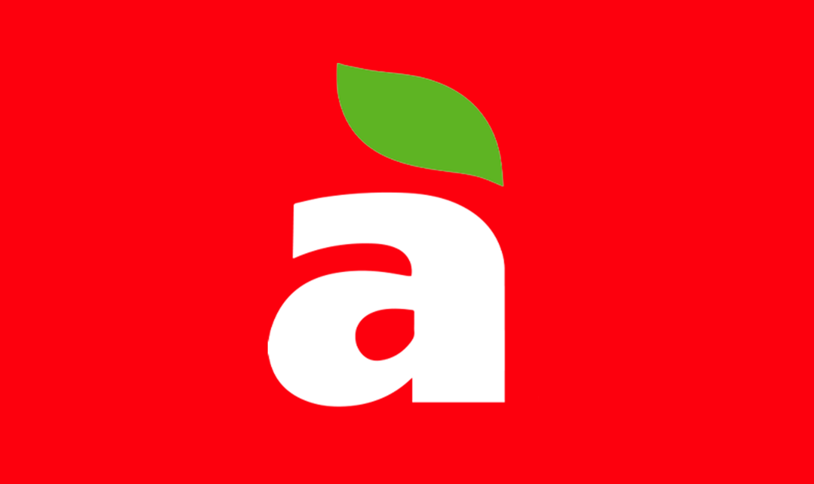

<div align="center">



# Alicorp | Sitio web corporativo

**Proyecto web inspirado en Alicorp, desarrollado con fines académicos.**

Una experiencia de navegación responsive para explorar información institucional, marcas, líneas de negocio y sostenibilidad, con un formulario de contacto conectado a un servidor en Python.


</div>

> [!NOTE]
> Este es un **proyecto académico no oficial**. No representa a Alicorp ni está afiliado con la empresa. Las marcas, nombres e imágenes incluidos se utilizan en el contexto del proyecto.

## Descripción

El proyecto presenta información sobre Alicorp mediante una interfaz organizada en secciones, con navegación superior y pie de página compartidos. Permite consultar un catálogo de marcas, filtrar productos por categoría, conocer distintas líneas de negocio y enviar consultas mediante un formulario.

La interfaz está construida con **HTML, CSS, Bootstrap y JavaScript**. Un servidor **Flask** sirve las páginas y recibe los datos del formulario, que se guardan localmente en un archivo **Excel** utilizando `openpyxl`.

## Funcionalidades

- **Navegación por secciones:** Inicio, Nosotros, Productos, Negocios, Sostenibilidad y Contacto.
- **Diseño adaptable:** interfaz basada en Bootstrap 5.1.3 y estilos CSS personalizados.
- **Información institucional:** historia, misión, visión y línea de tiempo de la empresa.
- **Catálogo de 11 marcas:** búsqueda en tiempo real y filtros de alimentos, cuidado del hogar y cuidado personal.
- **Marcas destacadas:** área visual para Primor, AlaCena, Don Vittorio y Casino.
- **Tres páginas de negocio:** Consumo masivo, Soluciones B2B y Acuicultura.
- **Sostenibilidad:** información de iniciativas y de los pilares Personas, Planeta y Prosperidad.
- **Formulario de contacto:** validación en el navegador y en el servidor, con mensajes de confirmación o error.
- **Registro en Excel:** fecha y hora, nombre, correo electrónico, asunto y mensaje de cada envío válido.

## Tecnologías utilizadas

| Capa | Tecnologías | Uso |
| --- | --- | --- |
| Interfaz | HTML5, CSS3, Bootstrap 5.1.3 | Estructura, estilos y componentes responsive |
| Interactividad | JavaScript | Filtros, búsqueda, validación y navegación |
| Backend | Python, Flask | Servidor HTTP y endpoint de contacto |
| Persistencia | `openpyxl`, Excel (`.xlsx`) | Guardado local de mensajes |

No utiliza React, Node.js ni una base de datos SQL: el almacenamiento actual se hace directamente en un archivo `.xlsx`.

## Estructura del proyecto

```text
ALICORP/
├── index.html                  # Página principal, encabezado y pie
├── contenido.html              # Secciones centrales del sitio
├── consumo-masivo.html         # Detalle de consumo masivo
├── soluciones-b2b.html         # Detalle de soluciones empresariales
├── acuicultura.html            # Detalle del negocio acuícola
├── servidor.py                 # Servidor Flask y API de contacto
├── requirements.txt            # Dependencias de Python
├── datos/
│   └── contactos.xlsx          # Archivo de registro de mensajes
├── css/
│   ├── bootstrap.min.css
│   ├── style.css
│   ├── alicorp.css
│   ├── alicorp-footer.css
│   ├── alicorp-secciones.css
│   ├── alicorp-actualizacion.css
│   └── alicorp-marco.css
├── js/
│   ├── bootstrap.bundle.min.js
│   ├── alicorp.js              # Productos, filtros y formulario
│   ├── alicorp-marco.js        # Navegación del marco principal
│   └── alicorp-contenido.js    # Comunicación con páginas internas
├── img/alicorp/               # Imágenes del contenido
├── logoALICORP.png
└── .vscode/
    └── settings.json
```

## Instalación y ejecución local

### Requisitos

- **Python 3.9 o superior** (se recomienda una versión reciente).
- `pip` para instalar las dependencias.
- Un navegador web actualizado.

### 1. Obtener el proyecto

Descarga el repositorio en formato ZIP o clónalo desde GitHub. Abre una terminal **dentro de la carpeta `ALICORP`**, donde se encuentra `servidor.py`.

### 2. Crear un entorno virtual

**Windows (PowerShell):**

```powershell
py -m venv .venv
.\.venv\Scripts\Activate.ps1
```

**Linux / macOS:**

```bash
python3 -m venv .venv
source .venv/bin/activate
```

> Si PowerShell impide activar el entorno, también puedes ejecutar las instrucciones siguientes usando directamente `.\.venv\Scripts\python.exe` en lugar de `python`.

### 3. Instalar dependencias

```bash
python -m pip install -r requirements.txt
```

Las dependencias declaradas por el proyecto son `Flask>=3.0,<4` y `openpyxl>=3.1,<4`.

### 4. Iniciar el servidor

```bash
python servidor.py
```

Abre en tu navegador:

**http://127.0.0.1:5000**

El servidor está configurado para ejecutarse localmente en `127.0.0.1`, puerto `5000`, con el modo de depuración desactivado.

> [!IMPORTANT]
> **No abras `index.html` directamente si quieres usar el formulario.** El envío utiliza `/api/contacto` y requiere que Flask esté en ejecución. Un servidor estático o GitHub Pages puede mostrar la interfaz, pero **no ejecutará el backend Python ni guardará mensajes en Excel**.

## Cómo funciona

### Navegación

`index.html` mantiene el encabezado y el pie de página y muestra el contenido central dentro de un `iframe`. Los archivos `alicorp-marco.js` y `alicorp-contenido.js` se comunican mediante `postMessage` para ajustar la altura, dirigir el desplazamiento a las secciones y actualizar el elemento activo del menú.

### Catálogo de productos

En la sección Productos puedes escribir el nombre de una marca o seleccionar una categoría. Los resultados se actualizan sin recargar la página; la búsqueda también contempla diferencias de tildes y mayúsculas.

### Formulario de contacto

1. El visitante completa nombre, correo electrónico, asunto y mensaje.
2. JavaScript comprueba los campos y envía una solicitud `POST` con JSON a `/api/contacto`.
3. Flask vuelve a validar los datos recibidos.
4. Si son válidos, `openpyxl` añade una fila a `datos/contactos.xlsx` con la fecha y hora del servidor.
5. La interfaz informa si el registro se realizó correctamente o si hubo un error.

El archivo Excel incluido inicialmente contiene solo las columnas:

| Fecha y hora | Nombre | Correo electrónico | Asunto | Mensaje |
| --- | --- | --- | --- | --- |

**Importante:** si el archivo Excel está abierto en un programa que bloquea la escritura, el registro podría fallar hasta cerrarlo.

## API de contacto

### `POST /api/contacto`

Envía un mensaje desde el formulario.

**Ejemplo de solicitud:**

```http
POST /api/contacto HTTP/1.1
Content-Type: application/json

{
  "nombre": "Nombre de ejemplo",
  "email": "ejemplo@correo.com",
  "asunto": "Consultas",
  "mensaje": "Quisiera recibir información sobre sus productos."
}
```

**Asuntos aceptados:** `Consultas`, `Reclamos`, `Cliente`, `Nuevo cliente`, `Proveedores` y `Otros`.

**Respuesta correcta (`201 Created`):**

```json
{"mensaje": "Guardado correctamente"}
```

**Datos inválidos (`400 Bad Request`):**

```json
{"error": "Revisa los datos del formulario."}
```

También puede responder con error `500` si no logra escribir el archivo Excel.

## Consideraciones y mejoras futuras

Este proyecto funciona como una demostración local. Antes de publicarlo para recibir mensajes reales, conviene considerar lo siguiente:

- **Privacidad:** el Excel contendrá nombres, correos y mensajes. No publiques un archivo que ya incluya información personal; guarda los datos reales fuera del repositorio.
- **Persistencia:** Excel es apropiado para una demostración o un volumen pequeño de consultas, pero una base de datos sería más conveniente para uso público o múltiples usuarios.
- **Protección del formulario:** se podría añadir limitación de solicitudes, protección antispam y políticas explícitas de tratamiento de datos.
- **Despliegue:** para mantener activo el formulario en Internet se necesita alojamiento que ejecute Python/Flask, además de un almacenamiento persistente. **GitHub Pages por sí solo no es suficiente.**
- **Pruebas:** sería útil incorporar pruebas automatizadas para la validación, el endpoint y el almacenamiento.

## Estado del proyecto

**Versión académica funcional a nivel de código**, con las páginas, recursos, navegación, catálogo y flujo de guardado implementados. El funcionamiento completo depende de instalar las dependencias y ejecutar el servidor Flask; no se incluye una configuración de despliegue público.

---

<div align="center">

**Proyecto académico de desarrollo web · Alicorp (implementación no oficial)**

</div>
